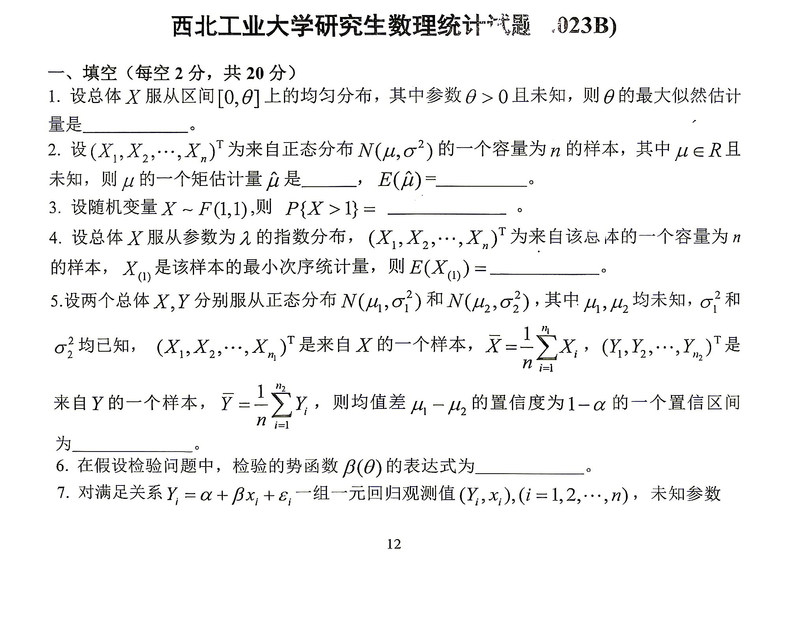
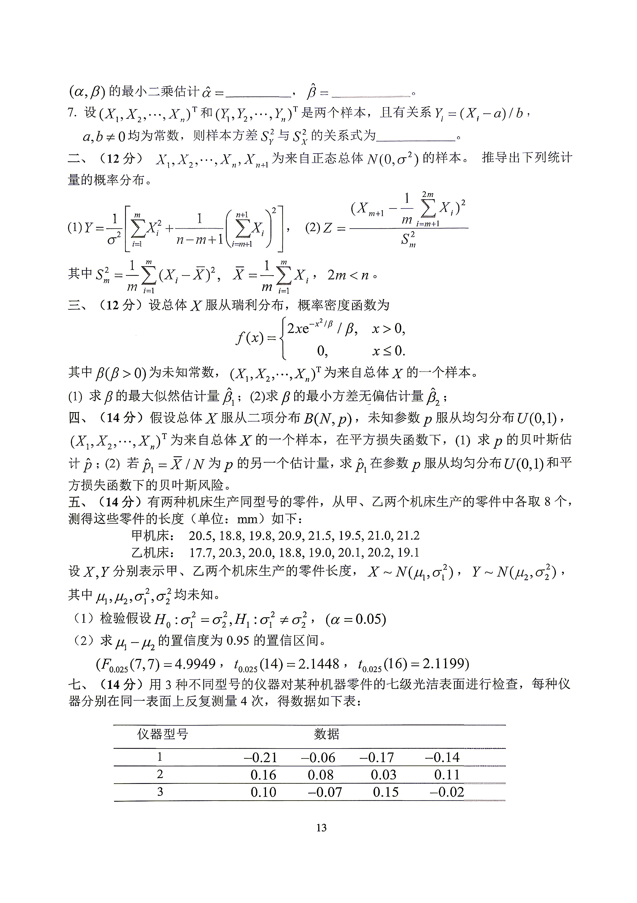
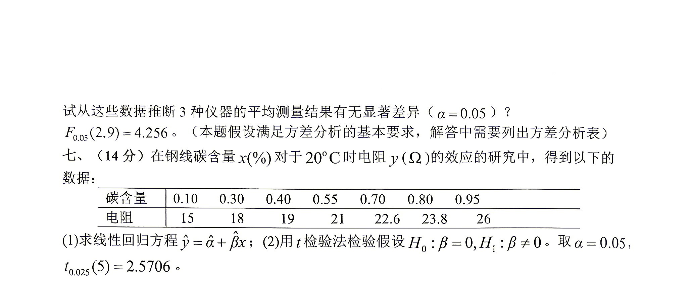

# 2023B

## 一、填空（每空2分，共20分）
1. 设总体 $X$ 服从区间 $[0, \theta]$ 上的均匀分布，其中参数 $\theta > 0$ 且未知，则 $\theta$ 的最大似然估计量是 $\underline{\quad\quad}$ 。

2. 设 $(X_1, X_2, \cdots, X_n)^\top$ 为来自正态分布 $N(\mu, \sigma^2)$ 的一个容量为 $n$ 的样本，其中 $\mu \in \mathbb{R}$ 且未知，则 $\mu$ 的一个矩估计量 $\hat{\mu}$ 是 $\underline{\quad\quad}$ ， $E(\hat{\mu}) =$ $\underline{\quad\quad}$ 。

3. 设随机变量 $X \sim F(1, 1)$ ，则 $P\lbrace X > 1\rbrace  =$ $\underline{\quad\quad}$ 。

4. 设总体 $X$ 服从参数为 $\lambda$ 的指数分布， $(X_1, X_2, \cdots, X_n)^\top$ 为来自该总体的一个容量为 $n$ 的样本， $X_{(1)}$ 是该样本的最小次序统计量，则 $E(X_{(1)}) =$ $\underline{\quad\quad}$ 。

5. 设两个总体 $X, Y$ 分别服从正态分布 $N(\mu_1, \sigma_1^2)$ 和 $N(\mu_2, \sigma_2^2)$ ，其中 $\mu_1, \mu_2$ 均未知， $\sigma_1^2$ 和 $\sigma_2^2$ 均已知， $(X_1, X_2, \cdots, X_{n_1})^\top$ 是来自 $X$ 的一个样本， $\bar{X} = \frac{1}{n_1}\sum\limits_{i=1}^{n_1} X_i$ ， $(Y_1, Y_2, \cdots, Y_{n_2})^\top$ 是来自 $Y$ 的一个样本， $\bar{Y} = \frac{1}{n_2}\sum\limits_{i=1}^{n_2} Y_i$ ，则均值差 $\mu_1 - \mu_2$ 的置信度为 $1 - \alpha$ 的一个置信区间为 $\underline{\quad\quad}$ 。

6. 在假设检验问题中，检验的势函数 $\beta(\theta)$ 的表达式为 $\underline{\quad\quad}$ 。

7. 对满足关系 $Y_i = \alpha + \beta x_i + \varepsilon_i$ 一组一元回归观测值 $(Y_i, x_i)\ (i = 1, 2, \cdots, n)$ ，未知参数 $(\alpha, \beta)$ 的最小二乘估计 $\hat{\alpha} =$ $\underline{\quad\quad}$ ， $\hat{\beta} =$ $\underline{\quad\quad}$ 。

8. 设 $(X_1, X_2, \cdots, X_n)^\top$ 和 $(Y_1, Y_2, \cdots, Y_n)^\top$ 是两个样本，且有关系 $Y_i = (X_i - a) / b$ ， $a, b \neq 0$ 均为常数，则样本方差 $S_Y^2$ 与 $S_X^2$ 的关系式为 $\underline{\quad\quad}$ 。

---

## 二、（12分）
$X_1, X_2, \cdots, X_n, X_{n+1}$ 为来自正态总体 $N(0, \sigma^2)$ 的样本。推导出下列统计量的概率分布。

(1) $Y = \frac{1}{\sigma^2}\left[\sum\limits_{i=1}^{m} X_i^2 + \frac{1}{n - m + 1}\left(\sum\limits_{i=m+1}^{n+1} X_i\right)^2\right]$ ，

(2) $Z = \frac{\left(X_{m+1} - \frac{1}{m}\sum\limits_{i=m+1}^{2m} X_i\right)^2}{S_m^2}$

其中 $S_m^2 = \frac{1}{m}\sum\limits_{i=1}^{m}(X_i - \bar{X})^2$ ， $\bar{X} = \frac{1}{m}\sum\limits_{i=1}^{m} X_i$ ， $2m < n$ 。

---

## 三、（12分）
设总体 $X$ 服从瑞利分布，概率密度函数为

$$
f(x) = \begin{cases} 2x e^{-x^2/\beta} / \beta, & x > 0, \cr 0, & x \leq 0. \end{cases}
$$

其中 $\beta\ (\beta > 0)$ 为未知常数， $(X_1, X_2, \cdots, X_n)^\top$ 为来自总体 $X$ 的一个样本。

(1) 求 $\beta$ 的最大似然估计量 $\hat{\beta}_1$ ；

(2) 求 $\beta$ 的最小方差无偏估计量 $\hat{\beta}_2$ ；

---

## 四、（14分）
假设总体 $X$ 服从二项分布 $B(N, p)$ ，未知参数 $p$ 服从均匀分布 $U(0, 1)$ ， $(X_1, X_2, \cdots, X_n)^\top$ 为来自总体 $X$ 的一个样本，在平方损失函数下，

(1) 求 $p$ 的贝叶斯估计 $\hat{p}$ ；

(2) 若 $\hat{p}_1 = \bar{X} / N$ 为 $p$ 的另一个估计量，求 $\hat{p}_1$ 在参数 $p$ 服从均匀分布 $U(0, 1)$ 和平方损失函数下的贝叶斯风险。

---

## 五、（14分）
有两种机床生产同型号的零件，从甲、乙两个机床生产的零件中各取 8 个，测得这些零件的长度（单位：mm）如下：

- 甲机床：20.5, 18.8, 19.8, 20.9, 21.5, 19.5, 21.0, 21.2
- 乙机床：17.7, 20.3, 20.0, 18.8, 19.0, 20.1, 20.2, 19.1

设 $X, Y$ 分别表示甲、乙两个机床生产的零件长度， $X \sim N(\mu_1, \sigma_1^2)$ ， $Y \sim N(\mu_2, \sigma_2^2)$ ，其中 $\mu_1, \mu_2, \sigma_1^2, \sigma_2^2$ 均未知。

(1) 检验假设 $H_0: \sigma_1^2 = \sigma_2^2,\ H_1: \sigma_1^2 \neq \sigma_2^2\ (\alpha = 0.05)$

(2) 求 $\mu_1 - \mu_2$ 的置信度为 0.95 的置信区间。

（ $F_{0.025}(7, 7) = 4.9949$ ， $t_{0.025}(14) = 2.1448$ ， $t_{0.025}(16) = 2.1199$ ）

---

## 六、（14分）
用 3 种不同型号的仪器对某种机器零件的七级光洁表面进行检查，每种仪器分别在同一表面上反复测量 4 次，得数据如下表：

| 仪器型号 | 数据 |
| --- | --- |
| 1 | -0.21, -0.06, -0.17, -0.14 |
| 2 | 0.16, 0.08, 0.03, 0.11 |
| 3 | 0.10, -0.07, 0.15, -0.02 |

试从这些数据推断 3 种仪器的平均测量结果有无显著差异（ $\alpha = 0.05$ ）？

$F_{0.05}(2, 9) = 4.256$ 。（本题假设满足方差分析的基本要求，解答中需要列出方差分析表）

---

## 七、（14分）
在钢线碳含量 $x\ (\%)$ 对于 $20^\circ\text{C}$ 时电阻 $y\ (\Omega)$ 的效应的研究中，得到以下的数据：

| 碳含量 | 0.10 | 0.30 | 0.40 | 0.55 | 0.70 | 0.80 | 0.95 |
| --- | --- | --- | --- | --- | --- | --- | --- |
| 电阻 | 15 | 18 | 19 | 21 | 22.6 | 23.8 | 26 |

(1) 求线性回归方程 $\hat{y} = \hat{\alpha} + \hat{\beta} x$ ；

(2) 用 $t$ 检验法检验假设 $H_0: \beta = 0,\ H_1: \beta \neq 0$ 。取 $\alpha = 0.05$ ， $t_{0.025}(5) = 2.5706$ 。

---

# 原始图片

