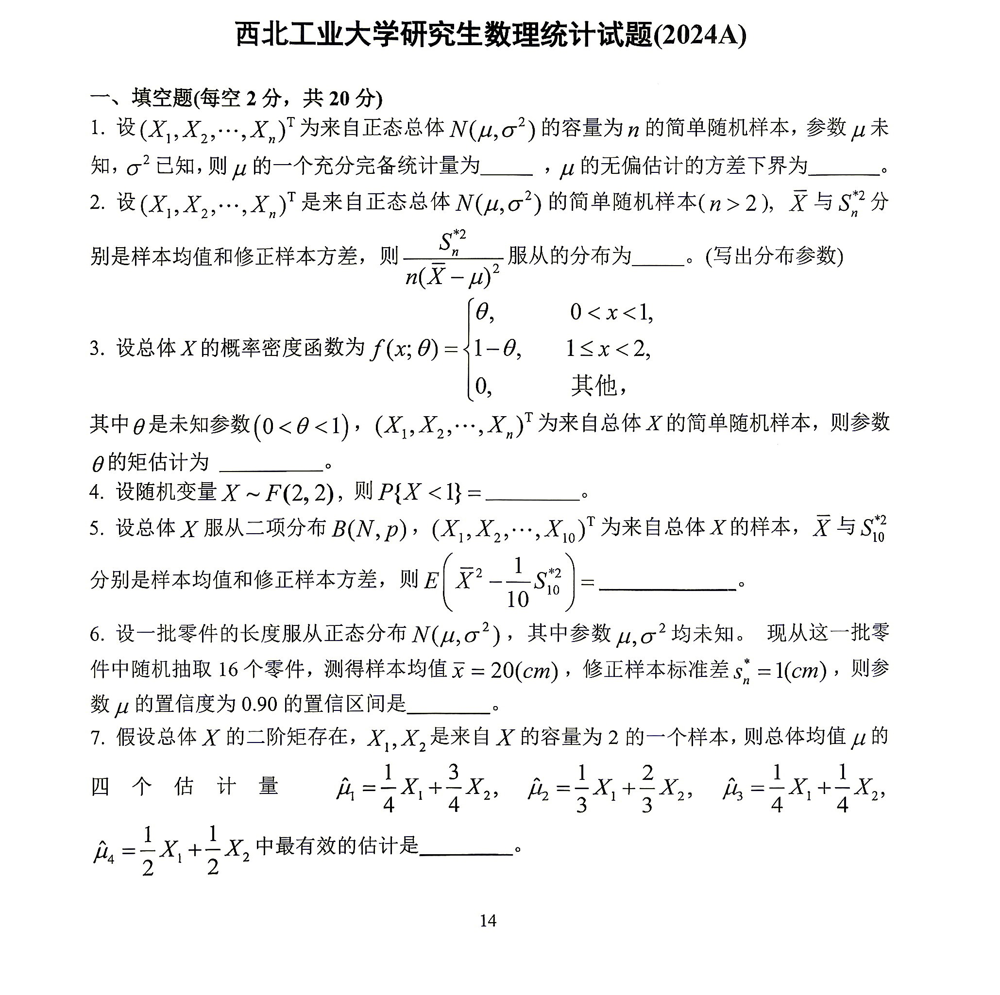
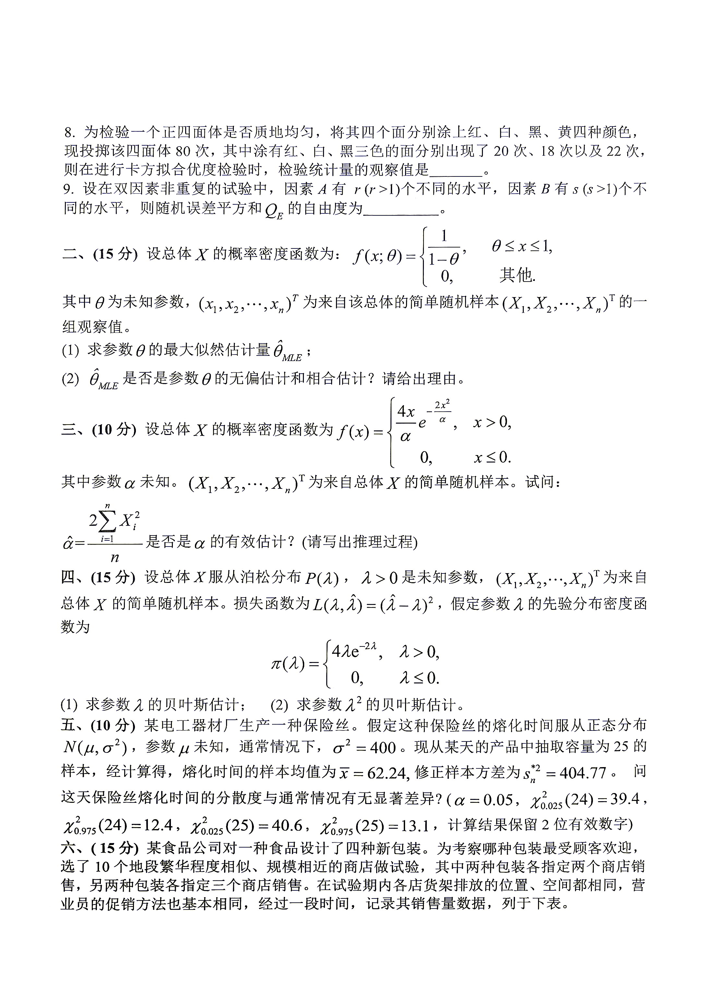
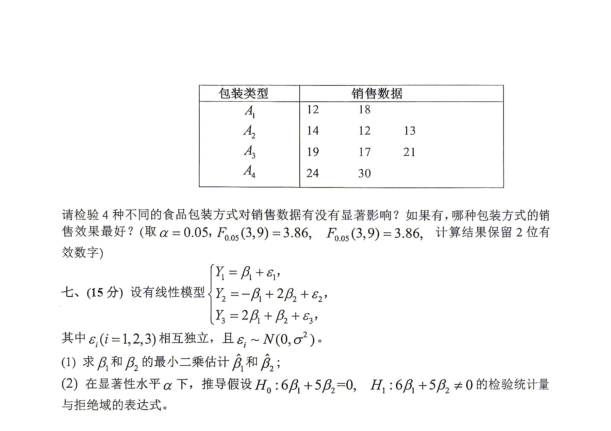

# 2024A

## 一、填空题（每空2分，共20分）
1. 设 $(X_1, X_2, \cdots, X_n)^\top$ 为来自正态总体 $N(\mu, \sigma^2)$ 的容量为 $n$ 的简单随机样本，参数 $\mu$ 未知， $\sigma^2$ 已知，则 $\mu$ 的一个充分完备统计量为 $\underline{\quad\quad}$ ， $\mu$ 的无偏估计的方差下界为 $\underline{\quad\quad}$ 。

2. 设 $(X_1, X_2, \cdots, X_n)^\top$ 是来自正态总体 $N(\mu, \sigma^2)$ 的简单随机样本（ $n > 2$ ）， $\bar{X}$ 与 $S_n^{*2}$ 分别是样本均值和修正样本方差，则 $\frac{S_n^{*2}}{n(\bar{X} - \mu)^2}$ 服从的分布为 $\underline{\quad\quad}$ 。（写出分布参数）

3. 设总体 $X$ 的概率密度函数为

   

$$
f(x; \theta) = \begin{cases} \theta, & 0 < x < 1, \cr 1 - \theta, & 1 \leq x < 2, \cr 0, & \text{其他}, \end{cases}
$$

   其中 $\theta$ 是未知参数（ $0 < \theta < 1$ ）， $(X_1, X_2, \cdots, X_n)^\top$ 为来自总体 $X$ 的简单随机样本，则参数 $\theta$ 的矩估计为 $\underline{\quad\quad}$ 。

4. 设随机变量 $X \sim F(2, 2)$ ，则 $P\lbrace X < 1\rbrace  =$ $\underline{\quad\quad}$ 。

5. 设总体 $X$ 服从二项分布 $B(N, p)$ ， $(X_1, X_2, \cdots, X_{10})^\top$ 为来自总体 $X$ 的样本， $\bar{X}$ 与 $S_{10}^{*2}$ 分别是样本均值和修正样本方差，则 $E\left(\bar{X}^2 - \frac{1}{10} S_{10}^{*2}\right) =$ $\underline{\quad\quad}$ 。

6. 设一批零件的长度服从正态分布 $N(\mu, \sigma^2)$ ，其中参数 $\mu, \sigma^2$ 均未知。现从这一批零件中随机抽取 16 个零件，测得样本均值 $\bar{x} = 20\ (\text{cm})$ ，修正样本标准差 $s_n^* = 1\ (\text{cm})$ ，则参数 $\mu$ 的置信度为 0.90 的置信区间是 $\underline{\quad\quad}$ 。

7. 假设总体 $X$ 的二阶矩存在， $X_1, X_2$ 是来自 $X$ 的容量为 2 的一个样本，则总体均值 $\mu$ 的四个估计量 $\hat{\mu}_1 = \frac{1}{4} X_1 + \frac{3}{4} X_2$ ， $\hat{\mu}_2 = \frac{1}{3} X_1 + \frac{2}{3} X_2$ ， $\hat{\mu}_3 = \frac{1}{4} X_1 + \frac{1}{4} X_2$ ， $\hat{\mu}_4 = \frac{1}{2} X_1 + \frac{1}{2} X_2$ 中最有效的估计是 $\underline{\quad\quad}$ 。

8. 为检验一个正四面体是否质地均匀，将其四个面分别涂上红、白、黑、黄四种颜色，现投掷该四面体 80 次，其中涂有红、白、黑三色的面分别出现了 20 次、18 次以及 22 次，则在进行卡方拟合优度检验时，检验统计量的观察值是 $\underline{\quad\quad}$ 。

9. 设在双因素非重复的试验中，因素 $A$ 有 $r\ (r > 1)$ 个不同的水平，因素 $B$ 有 $s\ (s > 1)$ 个不同的水平，则随机误差平方和 $Q_E$ 的自由度为 $\underline{\quad\quad}$ 。

---

## 二、（15分）
设总体 $X$ 的概率密度函数为：

$$
f(x; \theta) = \begin{cases} \frac{1}{1 - \theta}, & \theta \leq x \leq 1, \cr 0, & \text{其他}. \end{cases}
$$

其中 $\theta$ 为未知参数， $(x_1, x_2, \cdots, x_n)^\top$ 为来自该总体的简单随机样本 $(X_1, X_2, \cdots, X_n)^\top$ 的一组观察值。

(1) 求参数 $\theta$ 的最大似然估计量 $\hat{\theta}_{MLE}$ ；

(2) $\hat{\theta}_{MLE}$ 是否是参数 $\theta$ 的无偏估计和相合估计？请给出理由。

---

## 三、（10分）
设总体 $X$ 的概率密度函数为

$$
f(x) = \begin{cases} \frac{4x}{\alpha} e^{-\frac{2x^2}{\alpha}}, & x > 0, \cr 0, & x \leq 0. \end{cases}
$$

其中参数 $\alpha$ 未知。 $(X_1, X_2, \cdots, X_n)^\top$ 为来自总体 $X$ 的简单随机样本。试问：

$$
\hat{\alpha} = \frac{2\sum\limits_{i=1}^{n} X_i^2}{n}
$$

是否是 $\alpha$ 的有效估计？（请写出推理过程）

---

## 四、（15分）
设总体 $X$ 服从泊松分布 $P(\lambda)$ ， $\lambda > 0$ 是未知参数， $(X_1, X_2, \cdots, X_n)^\top$ 为来自总体 $X$ 的简单随机样本。损失函数为 $L(\lambda, \hat{\lambda}) = (\hat{\lambda} - \lambda)^2$ ，假定参数 $\lambda$ 的先验分布密度函数为

$$
\pi(\lambda) = \begin{cases} 4\lambda e^{-2\lambda}, & \lambda > 0, \cr 0, & \lambda \leq 0. \end{cases}
$$

(1) 求参数 $\lambda$ 的贝叶斯估计；

(2) 求参数 $\lambda^2$ 的贝叶斯估计。

---

## 五、（10分）
某电工器材厂生产一种保险丝。假定这种保险丝的熔化时间服从正态分布 $N(\mu, \sigma^2)$ ，参数 $\mu$ 未知，通常情况下， $\sigma^2 = 400$ 。现从某天的产品中抽取容量为 25 的样本，经计算得，熔化时间的样本均值为 $\bar{x} = 62.24$ ，修正样本方差为 $s_n^{*2} = 404.77$ 。问这天保险丝熔化时间的分散度与通常情况有无显著差异？（ $\alpha = 0.05$ ， $\chi_{0.025}^2(24) = 39.4$ ， $\chi_{0.975}^2(24) = 12.4$ ， $\chi_{0.025}^2(25) = 40.6$ ， $\chi_{0.975}^2(25) = 13.1$ ，计算结果保留 2 位有效数字）

---

## 六、（15分）
某食品公司对一种食品设计了四种新包装。为考察哪种包装最受顾客欢迎，选了 10 个地段繁华程度相似、规模相近的商店做试验，其中两种包装各指定两个商店销售，另两种包装各指定三个商店销售。在试验期内各店货架排放的位置、空间都相同，营业员的促销方法也基本相同，经过一段时间，记录其销售量数据，列于下表。

| 包装类型 | 销售数据 |
| --- | --- |
| $A_1$ | 12, 18 |
| $A_2$ | 14, 12, 13 |
| $A_3$ | 19, 17, 21 |
| $A_4$ | 24, 30 |

请检验 4 种不同的食品包装方式对销售数据有没有显著影响？如果有，哪种包装方式的销售效果最好？（取 $\alpha = 0.05$ ， $F_{0.05}(3, 9) = 3.86$ ，计算结果保留 2 位有效数字）

---

## 七、（15分）
设有线性模型

$$
\begin{cases} Y_1 = \beta_1 + \varepsilon_1, \cr Y_2 = -\beta_1 + 2\beta_2 + \varepsilon_2, \cr Y_3 = 2\beta_1 + \beta_2 + \varepsilon_3, \end{cases}
$$

其中 $\varepsilon_i\ (i = 1, 2, 3)$ 相互独立，且 $\varepsilon_i \sim N(0, \sigma^2)$ 。

(1) 求 $\beta_1$ 和 $\beta_2$ 的最小二乘估计 $\hat{\beta}_1$ 和 $\hat{\beta}_2$ ；

(2) 在显著性水平 $\alpha$ 下，推导假设 $H_0: 6\beta_1 + 5\beta_2 = 0,\ H_1: 6\beta_1 + 5\beta_2 \neq 0$ 的检验统计量与拒绝域的表达式。

---

# 原始图片

