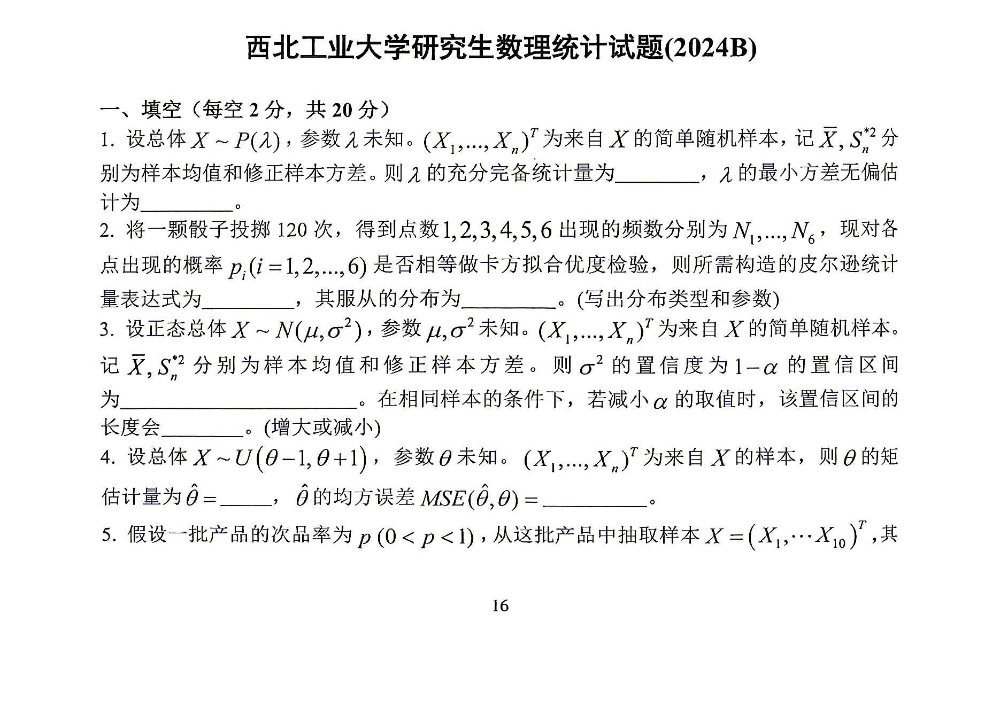
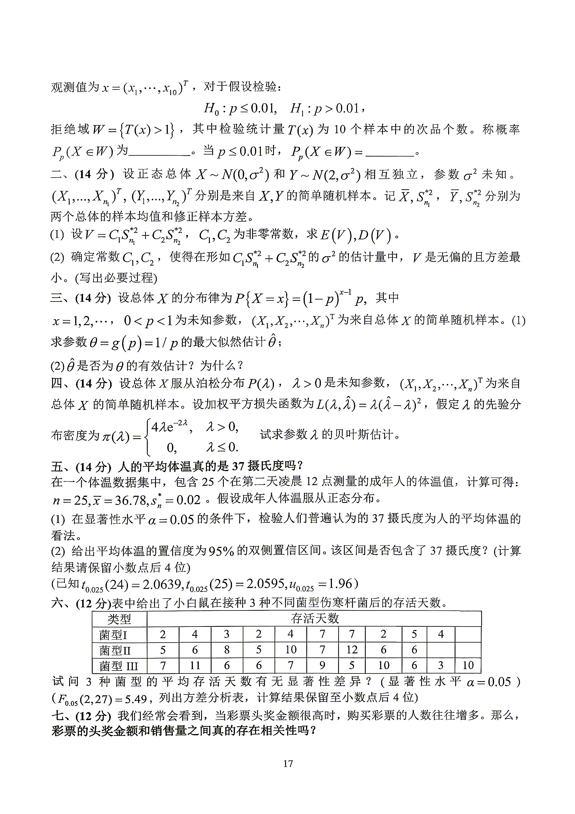
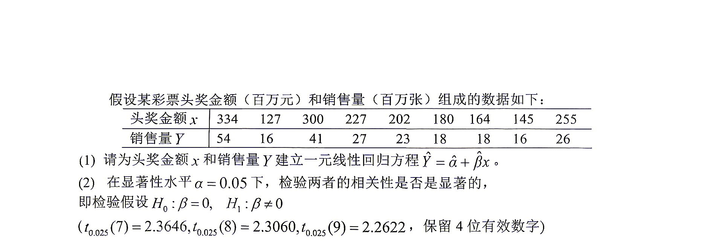

# 2024B

## 一、填空（每空2分，共20分）
1. 设总体 $X \sim P(\lambda)$ ，参数 $\lambda$ 未知。 $(X_1, \dots, X_n)^\top$ 为来自 $X$ 的简单随机样本，记 $\bar{X}, S_n^{*2}$ 分别为样本均值和修正样本方差。则 $\lambda$ 的充分完备统计量为 $\underline{\quad\quad}$ ， $\lambda$ 的最小方差无偏估计为 $\underline{\quad\quad}$ 。

2. 将一颗骰子投掷 120 次，得到点数 $1, 2, 3, 4, 5, 6$ 出现的频数分别为 $N_1, \dots, N_6$ ，现对各点出现的概率 $p_i\ (i = 1, 2, \dots, 6)$ 是否相等做卡方拟合优度检验，则所需构造的皮尔逊统计量表达式为 $\underline{\quad\quad}$ ，其服从的分布为 $\underline{\quad\quad}$ 。（写出分布类型和参数）

3. 设正态总体 $X \sim N(\mu, \sigma^2)$ ，参数 $\mu, \sigma^2$ 未知。 $(X_1, \dots, X_n)^\top$ 为来自 $X$ 的简单随机样本。记 $\bar{X}, S_n^{*2}$ 分别为样本均值和修正样本方差。则 $\sigma^2$ 的置信度为 $1 - \alpha$ 的置信区间为 $\underline{\quad\quad}$ 。在相同样本的条件下，若减小 $\alpha$ 的取值时，该置信区间的长度会 $\underline{\quad\quad}$ 。（增大或减小）

4. 设总体 $X \sim U(\theta - 1, \theta + 1)$ ，参数 $\theta$ 未知。 $(X_1, \dots, X_n)^\top$ 为来自 $X$ 的样本，则 $\theta$ 的矩估计量为 $\hat{\theta} =$ $\underline{\quad\quad}$ ， $\hat{\theta}$ 的均方误差 $MSE(\hat{\theta}, \theta) =$ $\underline{\quad\quad}$ 。

5. 假设一批产品的次品率为 $p\ (0 < p < 1)$ ，从这批产品中抽取样本 $X = (X_1, \cdots, X_{10})^\top$ ，其观测值为 $x = (x_1, \cdots, x_{10})^\top$ ，对于假设检验：

   

$$
H_0: p \leq 0.01, \quad H_1: p > 0.01,
$$

   拒绝域 $W = \lbrace T(x) > 1\rbrace$ ，其中检验统计量 $T(x)$ 为 10 个样本中的次品个数。称概率 $P_p(X \in W)$ 为 $\underline{\quad\quad}$ 。当 $p \leq 0.01$ 时， $P_p(X \in W) =$ $\underline{\quad\quad}$ 。

---

## 二、（14分）
设正态总体 $X \sim N(0, \sigma^2)$ 和 $Y \sim N(2, \sigma^2)$ 相互独立，参数 $\sigma^2$ 未知。 $(X_1, \dots, X_{n_1})^\top, (Y_1, \dots, Y_{n_2})^\top$ 分别是来自 $X, Y$ 的简单随机样本。记 $\bar{X}, S_{n_1}^{*2}, \bar{Y}, S_{n_2}^{*2}$ 分别为两个总体的样本均值和修正样本方差。

(1) 设 $V = C_1 S_{n_1}^{*2} + C_2 S_{n_2}^{*2}$ ， $C_1, C_2$ 为非零常数，求 $E(V), D(V)$ 。

(2) 确定常数 $C_1, C_2$ ，使得在形如 $C_1 S_{n_1}^{*2} + C_2 S_{n_2}^{*2}$ 的 $\sigma^2$ 的估计量中， $V$ 是无偏的且方差最小。（写出必要过程）

---

## 三、（14分）
设总体 $X$ 的分布律为 $P\lbrace X = x\rbrace  = (1 - p)^{x-1} p$ ，其中 $x = 1, 2, \cdots$ ， $0 < p < 1$ 为未知参数， $(X_1, X_2, \cdots, X_n)^\top$ 为来自总体 $X$ 的简单随机样本。

(1) 求参数 $\theta = g(p) = 1 / p$ 的最大似然估计 $\hat{\theta}$ ；

(2) $\hat{\theta}$ 是否为 $\theta$ 的有效估计？为什么？

---

## 四、（14分）
设总体 $X$ 服从泊松分布 $P(\lambda)$ ， $\lambda > 0$ 是未知参数， $(X_1, X_2, \cdots, X_n)^\top$ 为来自总体 $X$ 的简单随机样本。设加权平方损失函数为 $L(\lambda, \hat{\lambda}) = \lambda(\hat{\lambda} - \lambda)^2$ ，假定 $\lambda$ 的先验分布密度为

$$
\pi(\lambda) = \begin{cases} 4\lambda e^{-2\lambda}, & \lambda > 0, \cr 0, & \lambda \leq 0. \end{cases}
$$

试求参数 $\lambda$ 的贝叶斯估计。

---

## 五、（14分）
人的平均体温真的是 37 摄氏度吗？

在一个体温数据集中，包含 25 个在第二天凌晨 12 点测量的成年人的体温值，计算可得： $n = 25, \bar{x} = 36.78, s_n^* = 0.02$ 。假设成年人体温服从正态分布。

(1) 在显著性水平 $\alpha = 0.05$ 的条件下，检验人们普遍认为的 37 摄氏度为人的平均体温的看法。

(2) 给出平均体温的置信度为 95% 的双侧置信区间。该区间是否包含了 37 摄氏度？（计算结果请保留小数点后 4 位）

（已知 $t_{0.025}(24) = 2.0639, t_{0.025}(25) = 2.0595, u_{0.025} = 1.96$ ）

---

## 六、（12分）
表中给出了小白鼠在接种 3 种不同菌型伤寒杆菌后的存活天数。

| 类型 | 存活天数 |
| --- | --- |
| 菌型 I | 2, 4, 3, 2, 4, 7, 7, 2, 5, 4 |
| 菌型 II | 5, 6, 8, 5, 10, 7, 12, 6, 6 |
| 菌型 III | 7, 11, 6, 6, 7, 9, 5, 10, 6, 3, 10 |

试问 3 种菌型的平均存活天数有无显著性差异？（显著性水平 $\alpha = 0.05$ ）

（ $F_{0.05}(2, 27) = 5.49$ ，列出方差分析表，计算结果保留至小数点后 4 位）

---

## 七、（12分）
我们经常会看到，当彩票头奖金额很高时，购买彩票的人数往往增多。那么，彩票的头奖金额和销售量之间真的存在相关性吗？

假设某彩票头奖金额（百万元）和销售量（百万张）组成的数据如下：

| 头奖金额 $x$ | 334 | 127 | 300 | 227 | 202 | 180 | 164 | 145 | 255 |
| --- | --- | --- | --- | --- | --- | --- | --- | --- | --- |
| 销售量 $Y$ | 54 | 16 | 41 | 27 | 23 | 18 | 18 | 16 | 26 |

(1) 请为头奖金额 $x$ 和销售量 $Y$ 建立一元线性回归方程 $\hat{Y} = \hat{\alpha} + \hat{\beta} x$ 。

(2) 在显著性水平 $\alpha = 0.05$ 下，检验两者的相关性是否是显著的，即检验假设 $H_0: \beta = 0,\ H_1: \beta \neq 0$ 。

（ $t_{0.025}(7) = 2.3646, t_{0.025}(8) = 2.3060, t_{0.025}(9) = 2.2622$ ，保留 4 位有效数字）

---

# 原始图片

