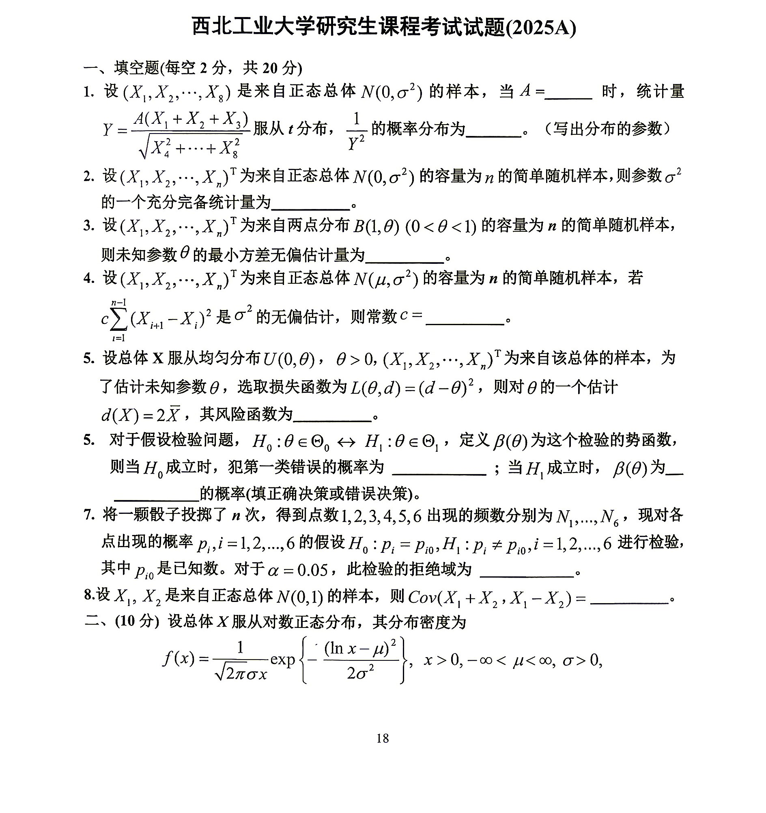
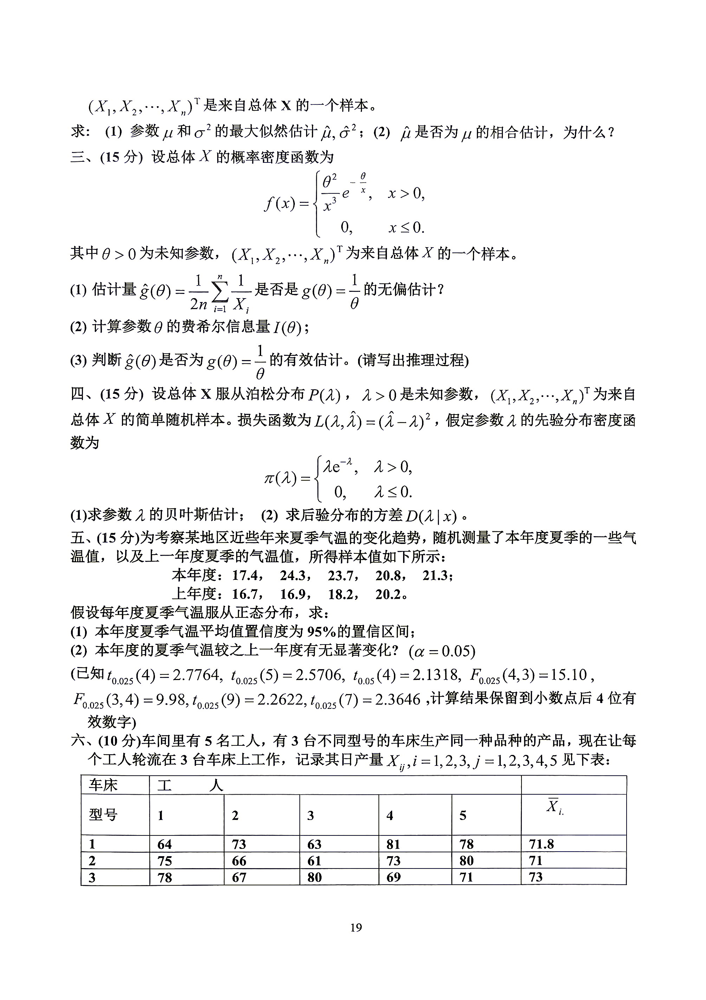
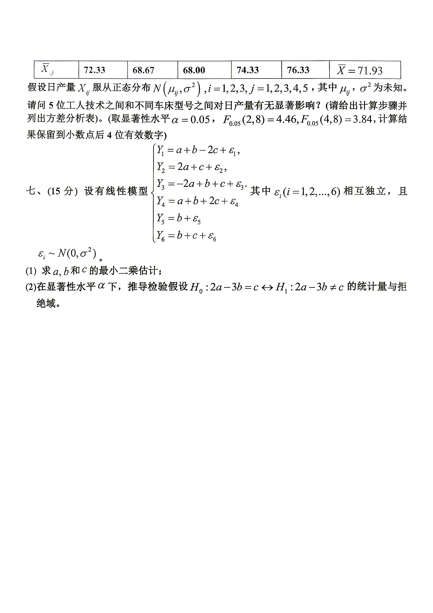

# 2025A

## 一、填空题（每空2分，共20分）
1. 设 $(X_1, X_2, \cdots, X_8)$ 是来自正态总体 $N(0, \sigma^2)$ 的样本，当 $A =$ $\underline{\quad\quad}$ 时，统计量 $Y = \frac{A(X_1 + X_2 + X_3)}{\sqrt{X_4^2 + \cdots + X_8^2}}$ 服从 $t$ 分布， $\frac{1}{Y^2}$ 的概率分布为 $\underline{\quad\quad}$ 。（写出分布的参数）

2. 设 $(X_1, X_2, \cdots, X_n)^\top$ 为来自正态总体 $N(0, \sigma^2)$ 的容量为 $n$ 的简单随机样本，则参数 $\sigma^2$ 的一个充分完备统计量为 $\underline{\quad\quad}$ 。

3. 设 $(X_1, X_2, \cdots, X_n)^\top$ 为来自两点分布 $B(1, \theta)\ (0 < \theta < 1)$ 的容量为 $n$ 的简单随机样本，则未知参数 $\theta$ 的最小方差无偏估计量为 $\underline{\quad\quad}$ 。

4. 设 $(X_1, X_2, \cdots, X_n)^\top$ 为来自正态总体 $N(\mu, \sigma^2)$ 的容量为 $n$ 的简单随机样本，若 $c\sum\limits_{i=1}^{n-1}(X_{i+1} - X_i)^2$ 是 $\sigma^2$ 的无偏估计，则常数 $c =$ $\underline{\quad\quad}$ 。

5. 设总体 $X$ 服从均匀分布 $U(0, \theta)$ ， $\theta > 0$ ， $(X_1, X_2, \cdots, X_n)^\top$ 为来自该总体的样本，为了估计未知参数 $\theta$ ，选取损失函数为 $L(\theta, d) = (d - \theta)^2$ ，则对 $\theta$ 的一个估计 $d(X) = 2\bar{X}$ ，其风险函数为 $\underline{\quad\quad}$ 。

6. 对于假设检验问题， $H_0: \theta \in \Theta_0 \leftrightarrow H_1: \theta \in \Theta_1$ ，定义 $\beta(\theta)$ 为这个检验的势函数，则当 $H_0$ 成立时，犯第一类错误的概率为 $\underline{\quad\quad}$ ；当 $H_1$ 成立时， $\beta(\theta)$ 为 $\underline{\quad\quad}$ 的概率（填正确决策或错误决策）。

7. 将一颗骰子投掷了 $n$ 次，得到点数 $1, 2, 3, 4, 5, 6$ 出现的频数分别为 $N_1, \dots, N_6$ ，现对各点出现的概率 $p_i, i = 1, 2, \dots, 6$ 的假设 $H_0: p_i = p_{i0}, H_1: p_i \neq p_{i0}, i = 1, 2, \dots, 6$ 进行检验，其中 $p_{i0}$ 是已知数。对于 $\alpha = 0.05$ ，此检验的拒绝域为 $\underline{\quad\quad}$ 。

8. 设 $X_1, X_2$ 是来自正态总体 $N(0, 1)$ 的样本，则 $\mathrm{Cov}(X_1 + X_2, X_1 - X_2) =$ $\underline{\quad\quad}$ 。

---

## 二、（10分）
设总体 $X$ 服从对数正态分布，其分布密度为

$$
f(x) = \frac{1}{\sqrt{2\pi}\sigma x}\exp\left\lbrace -\frac{(\ln x - \mu)^2}{2\sigma^2}\right\rbrace, \quad x > 0, -\infty < \mu < \infty, \sigma > 0,
$$

$(X_1, X_2, \cdots, X_n)^\top$ 是来自总体 $X$ 的一个样本。

求：

(1) 参数 $\mu$ 和 $\sigma^2$ 的最大似然估计 $\hat{\mu}, \hat{\sigma}^2$ ；

(2) $\hat{\mu}$ 是否为 $\mu$ 的相合估计，为什么？

---

## 三、（15分）
设总体 $X$ 的概率密度函数为

$$
f(x) = \begin{cases} \frac{\theta^2}{x^3} e^{-\frac{\theta}{x}}, & x > 0, \cr 0, & x \leq 0. \end{cases}
$$

其中 $\theta > 0$ 为未知参数， $(X_1, X_2, \cdots, X_n)^\top$ 为来自总体 $X$ 的一个样本。

(1) 估计量 $\hat{g}(\theta) = \frac{1}{2n}\sum\limits_{i=1}^{n}\frac{1}{X_i}$ 是否是 $g(\theta) = \frac{1}{\theta}$ 的无偏估计？

(2) 计算参数 $\theta$ 的费希尔信息量 $I(\theta)$ ；

(3) 判断 $\hat{g}(\theta)$ 是否为 $g(\theta) = \frac{1}{\theta}$ 的有效估计。（请写出推理过程）

---

## 四、（15分）
设总体 $X$ 服从泊松分布 $P(\lambda)$ ， $\lambda > 0$ 是未知参数， $(X_1, X_2, \cdots, X_n)^\top$ 为来自总体 $X$ 的简单随机样本。损失函数为 $L(\lambda, \hat{\lambda}) = (\hat{\lambda} - \lambda)^2$ ，假定参数 $\lambda$ 的先验分布密度函数为

$$
\pi(\lambda) = \begin{cases} \lambda e^{-\lambda}, & \lambda > 0, \cr 0, & \lambda \leq 0. \end{cases}
$$

(1) 求参数 $\lambda$ 的贝叶斯估计；

(2) 求后验分布的方差 $D(\lambda \mid x)$ 。

---

## 五、（15分）
为考察某地区近些年来夏季气温的变化趋势，随机测量了本年度夏季的一些气温值，以及上一年度夏季的气温值，所得样本值如下所示：

- 本年度：17.4, 24.3, 23.7, 20.8, 21.3；
- 上年度：16.7, 16.9, 18.2, 20.2。

假设每年度夏季气温服从正态分布，求：

(1) 本年度夏季气温平均值置信度为 95% 的置信区间；

(2) 本年度的夏季气温较之上一年度有无显著变化？（ $\alpha = 0.05$ ）

（已知 $t_{0.025}(4) = 2.7764, t_{0.025}(5) = 2.5706, t_{0.05}(4) = 2.1318, F_{0.025}(4, 3) = 15.10, F_{0.025}(3, 4) = 9.98, t_{0.025}(9) = 2.2622, t_{0.025}(7) = 2.3646$ ，计算结果保留到小数点后 4 位有效数字）

---

## 六、（10分）
车间里有 5 名工人，有 3 台不同型号的车床生产同一种品种的产品，现在让每个工人轮流在 3 台车床上工作，记录其日产量 $X_{ij}, i = 1, 2, 3, j = 1, 2, 3, 4, 5$ 见下表：

| 车床型号 \ 工人 | 1 | 2 | 3 | 4 | 5 | $\bar{X}_{i\cdot}$ |
| --- | --- | --- | --- | --- | --- | --- |
| 1 | 64 | 73 | 63 | 81 | 78 | 71.8 |
| 2 | 75 | 66 | 61 | 73 | 80 | 71 |
| 3 | 78 | 67 | 80 | 69 | 71 | 73 |
| $\bar{X}_{\cdot j}$ | 72.33 | 68.67 | 68.00 | 74.33 | 76.33 | $\bar{X} = 71.93$ |

假设日产量 $X_{ij}$ 服从正态分布 $N(\mu_{ij}, \sigma^2), i = 1, 2, 3, j = 1, 2, 3, 4, 5$ ，其中 $\mu_{ij}, \sigma^2$ 为未知。

请问 5 位工人技术之间和不同车床型号之间对日产量有无显著影响？（请给出计算步骤并列出方差分析表）。（取显著性水平 $\alpha = 0.05$ ， $F_{0.05}(2, 8) = 4.46, F_{0.05}(4, 8) = 3.84$ ，计算结果保留到小数点后 4 位有效数字）

---

## 七、（15分）
设有线性模型

$$
\begin{cases} Y_1 = a + b - 2c + \varepsilon_1, \cr Y_2 = 2a + c + \varepsilon_2, \cr Y_3 = -2a + b + c + \varepsilon_3, \cr Y_4 = a + b + 2c + \varepsilon_4, \cr Y_5 = b + \varepsilon_5, \cr Y_6 = b + c + \varepsilon_6, \end{cases}
$$

其中 $\varepsilon_i\ (i = 1, 2, \dots, 6)$ 相互独立，且 $\varepsilon_i \sim N(0, \sigma^2)$ 。

(1) 求 $a, b$ 和 $c$ 的最小二乘估计；

(2) 在显著性水平 $\alpha$ 下，推导检验假设 $H_0: 2a - 3b = c \leftrightarrow H_1: 2a - 3b \neq c$ 的统计量与拒绝域。

---

# 原始图片

