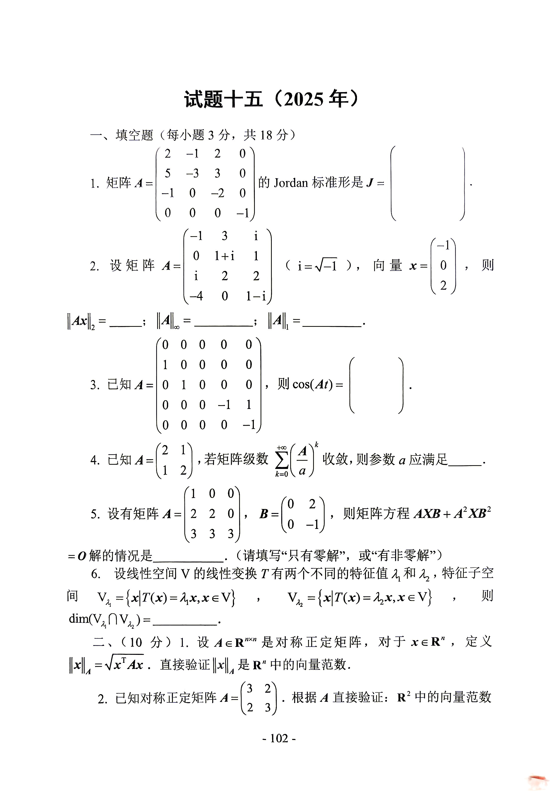
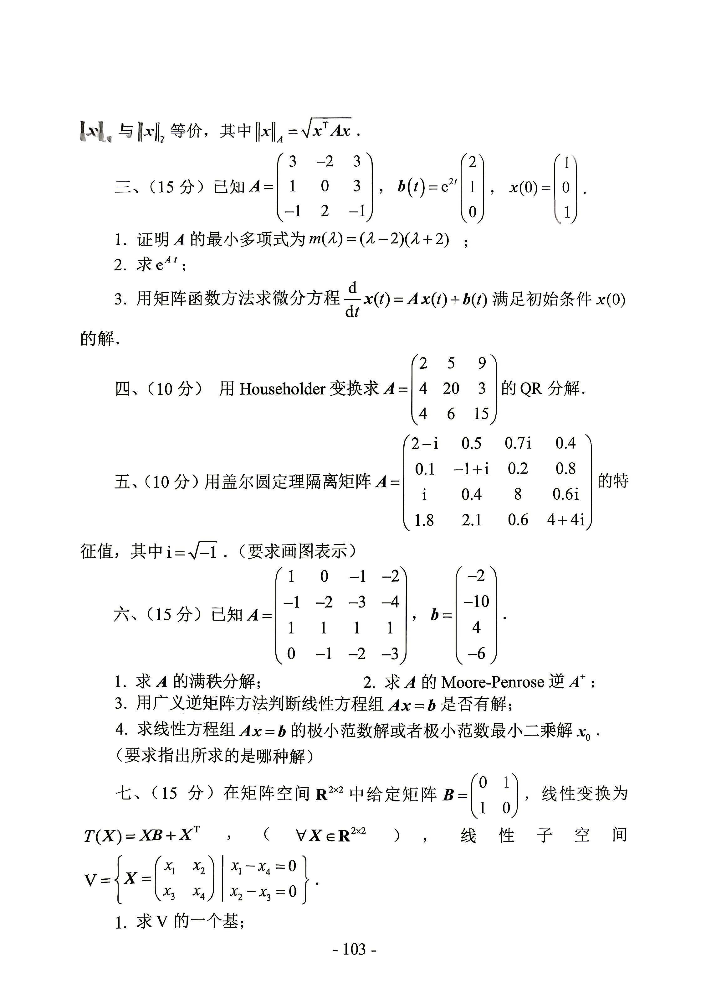
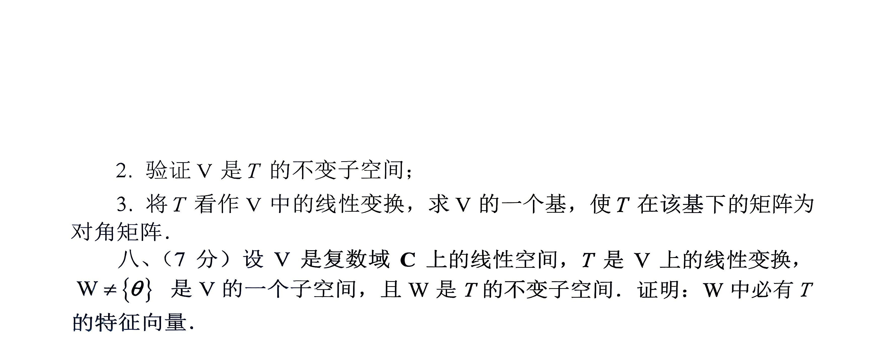

# 2025年

# 试题十五（2025年）
## 一、填空题（每小题3分，共18分）
1. 矩阵 $\boldsymbol{A} = \begin{pmatrix} 2 & -1 & 2 & 0 \cr 5 & -3 & 3 & 0 \cr -1 & 0 & -2 & 0 \cr 0 & 0 & 0 & -1 \end{pmatrix}$ 的 Jordan 标准形是 $\boldsymbol{J} =$ （ ）。

2. 设矩阵 $\boldsymbol{A} = \begin{pmatrix} -1 & 3 & \mathrm{i} \cr 0 & 1+\mathrm{i} & 1 \cr \mathrm{i} & 2 & 2 \cr -4 & 0 & 1-\mathrm{i} \end{pmatrix}\ (\mathrm{i} = \sqrt{-1})$ ，向量 $\boldsymbol{x} = \begin{pmatrix} -1 \cr 0 \cr 2 \end{pmatrix}$ ，则 $\Vert \boldsymbol{A}\boldsymbol{x}\Vert_2 =$ $\underline{\quad\quad}$ ； $\Vert \boldsymbol{A}\Vert_\infty =$ $\underline{\quad\quad}$ ； $\Vert \boldsymbol{A}\Vert_1 =$ $\underline{\quad\quad}$ 。

3. 已知 $\boldsymbol{A} = \begin{pmatrix} 0 & 0 & 0 & 0 & 0 \cr 1 & 0 & 0 & 0 & 0 \cr 0 & 1 & 0 & 0 & 0 \cr 0 & 0 & 0 & -1 & 1 \cr 0 & 0 & 0 & 0 & -1 \end{pmatrix}$ ，则 $\cos(\boldsymbol{A}t) =$ （ ）。

4. 已知 $\boldsymbol{A} = \begin{pmatrix} 2 & 1 \cr 1 & 2 \end{pmatrix}$ ，若矩阵级数 $\sum\limits_{k=0}^{+\infty} \left(\frac{\boldsymbol{A}}{a}\right)^k$ 收敛，则参数 $a$ 应满足 $\underline{\quad\quad}$ 。

5. 设有矩阵 $\boldsymbol{A} = \begin{pmatrix} 1 & 0 & 0 \cr 2 & 2 & 0 \cr 3 & 3 & 3 \end{pmatrix}$ ， $\boldsymbol{B} = \begin{pmatrix} 0 & 2 \cr 0 & -1 \end{pmatrix}$ ，则矩阵方程 $\boldsymbol{A}\boldsymbol{X}\boldsymbol{B} + \boldsymbol{A}^2 \boldsymbol{X} \boldsymbol{B}^2 = \boldsymbol{O}$ 解的情况是 $\underline{\quad\quad}$ 。（请填写“只有零解”，或“有非零解”）

6. 设线性空间 $V$ 的线性变换 $T$ 有两个不同的特征值 $\lambda_1$ 和 $\lambda_2$ ，特征子空间 $V_{\lambda_1} = \lbrace \boldsymbol{x} \mid T(\boldsymbol{x}) = \lambda_1 \boldsymbol{x}, \boldsymbol{x} \in V\rbrace$ ， $V_{\lambda_2} = \lbrace \boldsymbol{x} \mid T(\boldsymbol{x}) = \lambda_2 \boldsymbol{x}, \boldsymbol{x} \in V\rbrace$ ，则 $\dim(V_{\lambda_1} \cap V_{\lambda_2}) =$ $\underline{\quad\quad}$ 。

---

## 二、（10分）
1. 设 $\boldsymbol{A} \in \mathbb{R}^{n \times n}$ 是对称正定矩阵，对于 $\boldsymbol{x} \in \mathbb{R}^n$ ，定义 $\Vert \boldsymbol{x}\Vert_{\boldsymbol{A}} = \sqrt{\boldsymbol{x}^\top \boldsymbol{A} \boldsymbol{x}}$ 。直接验证 $\Vert \boldsymbol{x}\Vert_{\boldsymbol{A}}$ 是 $\mathbb{R}^n$ 中的向量范数。
2. 已知对称正定矩阵 $\boldsymbol{A} = \begin{pmatrix} 3 & 2 \cr 2 & 3 \end{pmatrix}$ 。根据 $\boldsymbol{A}$ 直接验证： $\mathbb{R}^2$ 中的向量范数 $\Vert \boldsymbol{x}\Vert_{\boldsymbol{A}}$ 与 $\Vert \boldsymbol{x}\Vert_2$ 等价，其中 $\Vert \boldsymbol{x}\Vert_{\boldsymbol{A}} = \sqrt{\boldsymbol{x}^\top \boldsymbol{A} \boldsymbol{x}}$ 。

---

## 三、（15分）
已知 $\boldsymbol{A} = \begin{pmatrix} 3 & -2 & 3 \cr 1 & 0 & 3 \cr -1 & 2 & -1 \end{pmatrix}$ ， $\boldsymbol{b}(t) = e^{2t} \begin{pmatrix} 2 \cr 1 \cr 0 \end{pmatrix}$ ， $\boldsymbol{x}(0) = \begin{pmatrix} 1 \cr 0 \cr 1 \end{pmatrix}$ 。

1. 证明 $\boldsymbol{A}$ 的最小多项式为 $m(\lambda) = (\lambda - 2)(\lambda + 2)$ ；
2. 求 $e^{\boldsymbol{A}t}$ ；
3. 用矩阵函数方法求微分方程 $\frac{\mathrm{d}}{\mathrm{d}t}\boldsymbol{x}(t) = \boldsymbol{A}\boldsymbol{x}(t) + \boldsymbol{b}(t)$ 满足初始条件 $\boldsymbol{x}(0)$ 的解。

---

## 四、（10分）
用 Householder 变换求 $\boldsymbol{A} = \begin{pmatrix} 2 & 5 & 9 \cr 4 & 20 & 3 \cr 4 & 6 & 15 \end{pmatrix}$ 的 QR 分解。

---

## 五、（10分）
用盖尔圆定理隔离矩阵 $\boldsymbol{A} = \begin{pmatrix} 2-\mathrm{i} & 0.5 & 0.7\mathrm{i} & 0.4 \cr 0.1 & -1+\mathrm{i} & 0.2 & 0.8 \cr \mathrm{i} & 0.4 & 8 & 0.6\mathrm{i} \cr 1.8 & 2.1 & 0.6 & 4+4\mathrm{i} \end{pmatrix}$ 的特征值，其中 $\mathrm{i} = \sqrt{-1}$ 。（要求画图表示）

---

## 六、（15分）
已知 $\boldsymbol{A} = \begin{pmatrix} 1 & 0 & -1 & -2 \cr -1 & -2 & -3 & -4 \cr 1 & 1 & 1 & 1 \cr 0 & -1 & -2 & -3 \end{pmatrix}$ ， $\boldsymbol{b} = \begin{pmatrix} -2 \cr -10 \cr 4 \cr -6 \end{pmatrix}$ 。

1. 求 $\boldsymbol{A}$ 的满秩分解；
2. 求 $\boldsymbol{A}$ 的 Moore-Penrose 逆 $\boldsymbol{A}^+$ ；
3. 用广义逆矩阵方法判断线性方程组 $\boldsymbol{A}\boldsymbol{x} = \boldsymbol{b}$ 是否有解；
4. 求线性方程组 $\boldsymbol{A}\boldsymbol{x} = \boldsymbol{b}$ 的极小范数解或者极小范数最小二乘解 $\boldsymbol{x}_0$ 。（要求指出所求的是哪种解）

---

## 七、（15分）
在矩阵空间 $\mathbb{R}^{2 \times 2}$ 中给定矩阵 $\boldsymbol{B} = \begin{pmatrix} 0 & 1 \cr 1 & 0 \end{pmatrix}$ ，线性变换为 $T(\boldsymbol{X}) = \boldsymbol{X}\boldsymbol{B} + \boldsymbol{X}^\top\ (\forall \boldsymbol{X} \in \mathbb{R}^{2 \times 2})$ ，线性子空间

$$
V = \left\lbrace  \boldsymbol{X} = \begin{pmatrix} x_1 & x_2 \cr x_3 & x_4 \end{pmatrix} \,\middle|\, \begin{aligned} x_1 - x_4 &= 0 \cr x_2 - x_3 &= 0 \end{aligned} \right\rbrace.
$$

1. 求 $V$ 的一个基；
2. 验证 $V$ 是 $T$ 的不变子空间；
3. 将 $T$ 看作 $V$ 中的线性变换，求 $V$ 的一个基，使 $T$ 在该基下的矩阵为对角矩阵。

---

## 八、（7分）
设 $V$ 是复数域 $\mathbb{C}$ 上的线性空间， $T$ 是 $V$ 上的线性变换， $W \neq \lbrace \boldsymbol{\theta}\rbrace$ 是 $V$ 的一个子空间，且 $W$ 是 $T$ 的不变子空间。证明： $W$ 中必有 $T$ 的特征向量。

---

